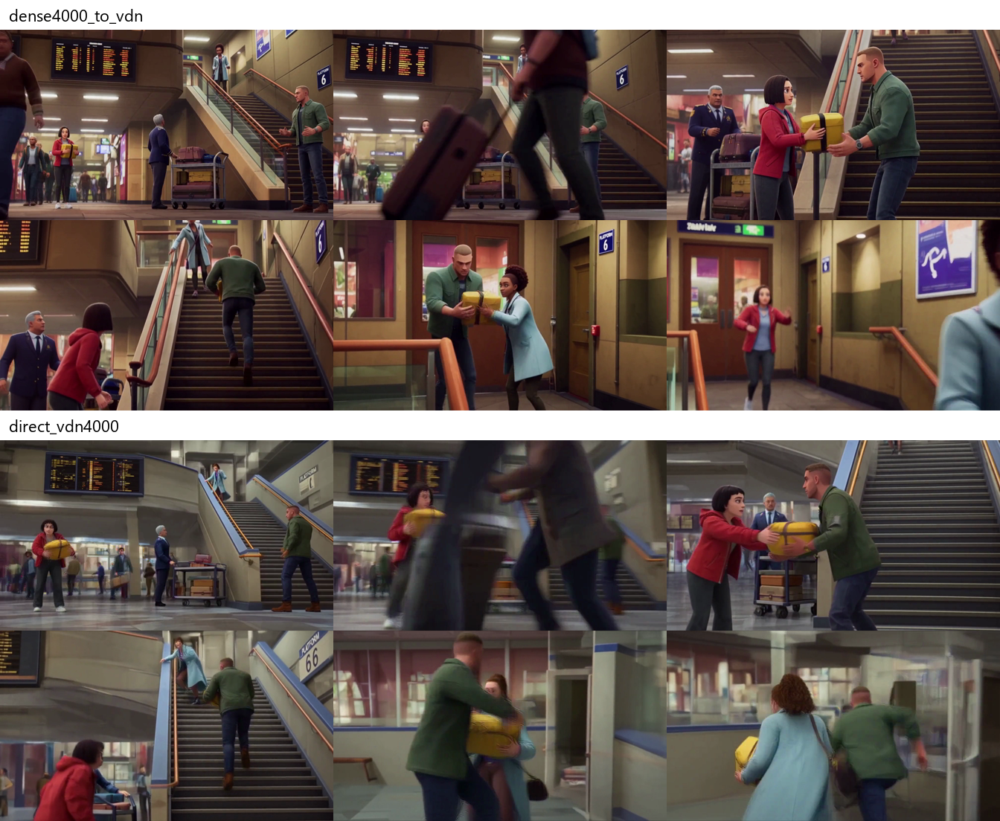
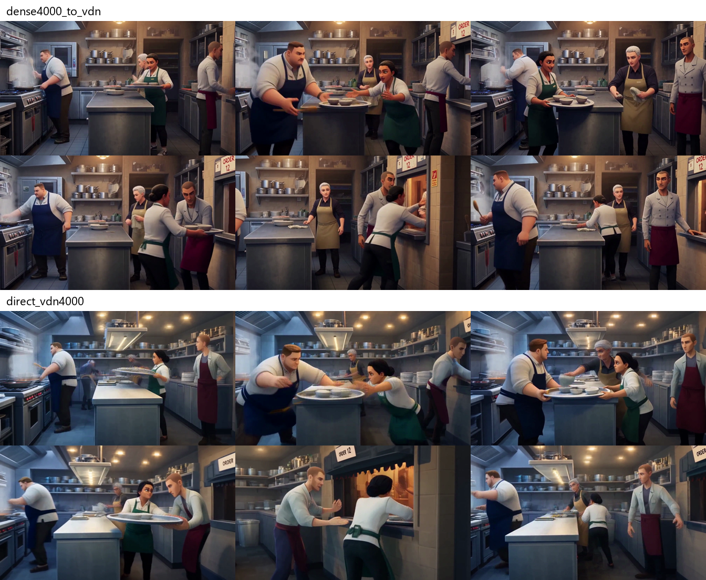
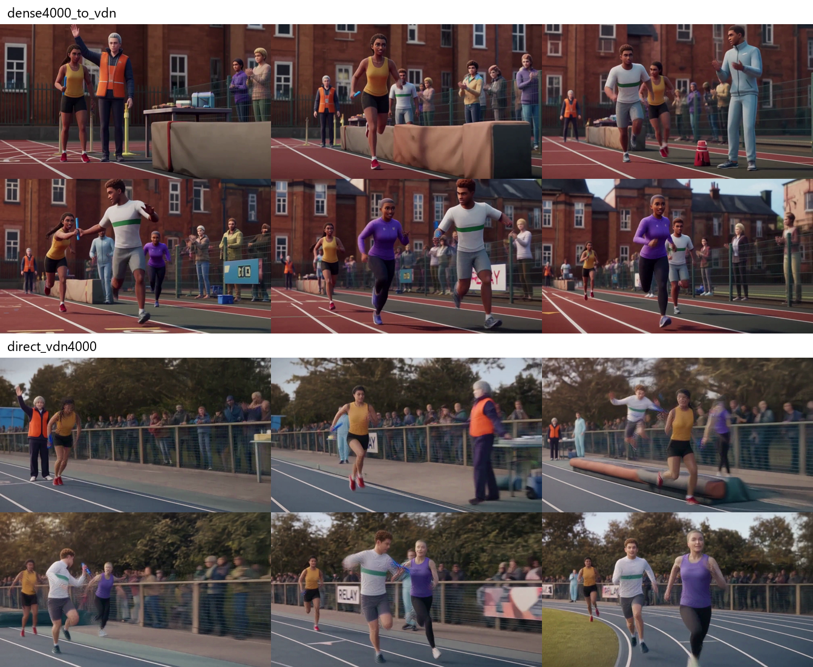
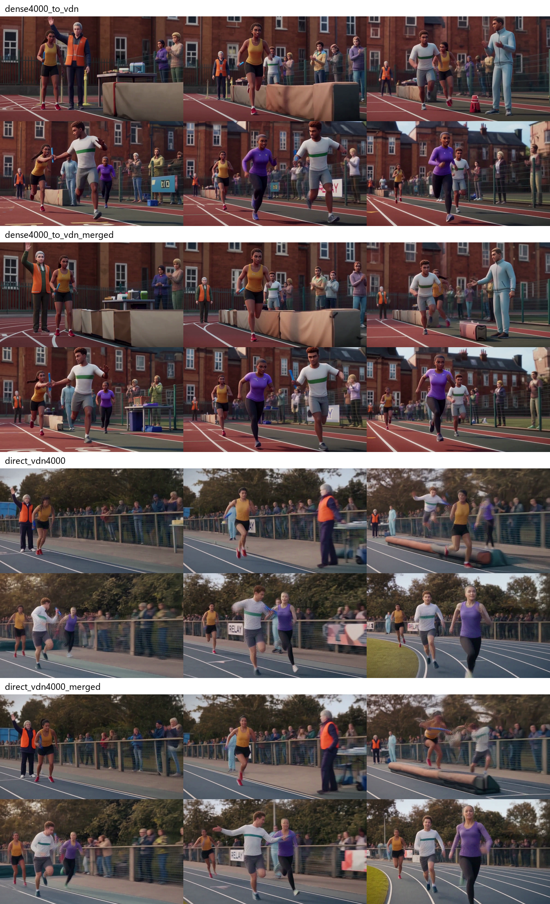
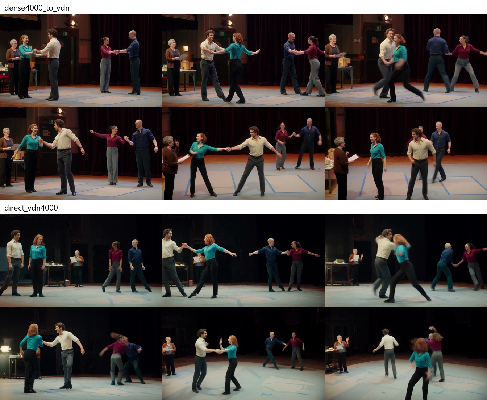
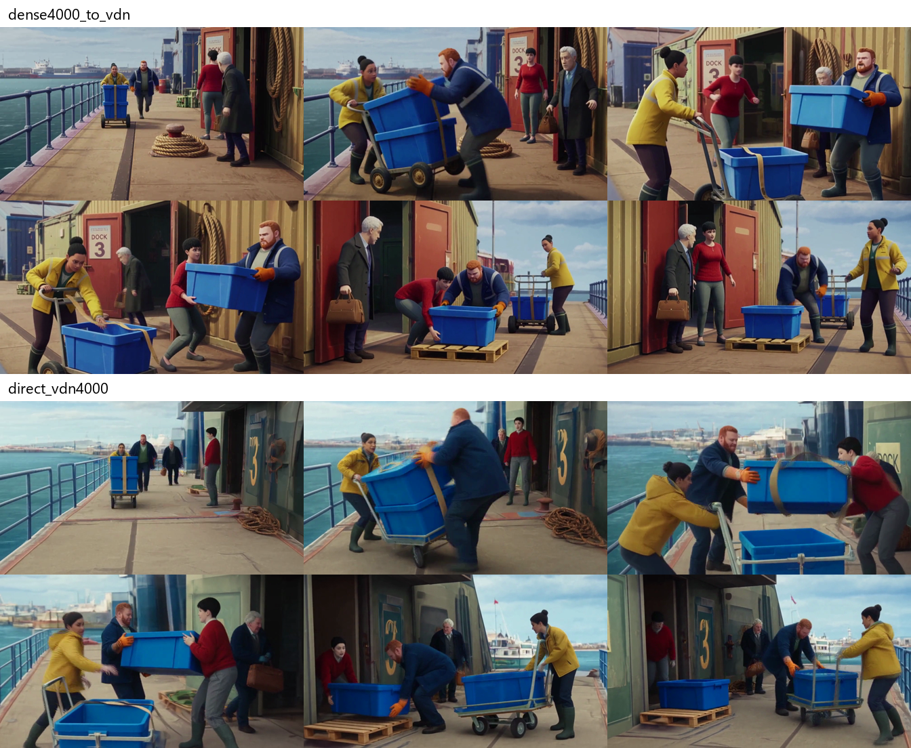
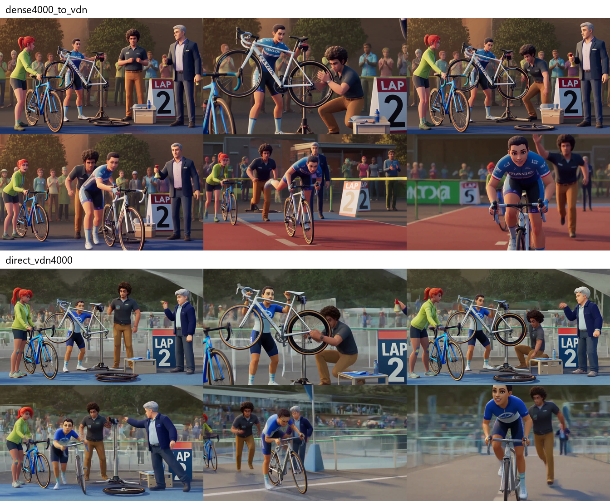

# Original H3 transfer versus direct VDN training

This compares two ways of training LoRA for artistic 3D animation. **All videos are generated on the same VDN**, the accelerated version of MiniMax H3. Only the trained adapter changes.

- **Left:** LoRA trained on original MiniMax H3, then transferred to VDN.
- **Right:** LoRA trained directly on VDN and applied to VDN.

Both adapters were trained on 780 images for **4000 presentations**. Within each pair, the scene description, initial noise and LoRA strength **1** match. No reference images are used. These are new scenes, not training captions; the descriptions contain no 3D or animation instructions, only the style trigger `vstyleh3`.

**What we observe:** direct VDN training causes substantially stronger motion degradation—in every recipe we tried—than transfer from original H3. Transfer still leaves errors, but far fewer. The main problem is fast body and object motion: limbs and complex mechanisms break down, much like a heavily quantized model or early video-diffusion models. Style also disappears on some scenes: the partner rehearsal below is mostly photorealistic in both variants. **The cause is unknown.** We expected the style learned on other scenes to hold here too; checks of prompt formatting, adapter identities and application did not explain this contradiction. Dependence on scene type is one possible explanation, but seems unlikely.

**Six pairs and a control pair after weight merging.**

Videos: 14.375 s, 1344×768, 24 fps, 8 generation steps, FAST FP8. One seed per scene. [Exact settings and results](../../docs/11-new-scene-comparison.md). [Metadata and SHA](../../evidence/media-manifest.json).

## N01 — Parcel relay in a railway concourse

<table>
<thead><tr><th>Trained on original MiniMax H3 LoRA transferred to VDN</th><th>Trained directly on VDN LoRA applied to VDN</th></tr></thead>
<tbody><tr><td width="420"><video src="https://github.com/user-attachments/assets/b3704c42-5b2c-478b-9188-401e70e02389" width="420" controls></video></td>
<td width="420"><video src="https://github.com/user-attachments/assets/cafce6d6-ebe9-4125-92f2-4e400b208e36" width="420" controls></video></td></tr></tbody>
</table>

Full prompt · seed 20261006 · identical within the pair

<pre>integrated_multimodal_description: [Shot 1] vstyleh3. A wide view inside a busy railway concourse establishes four adults and their separate paths through the hall. Mara, a woman in her thirties with a short dark bob, a red rain jacket, charcoal trousers and white trainers, holds a small rectangular yellow parcel with a black strap against her chest. Ivo, a tall man with close-cropped hair, a green overshirt, dark jeans and brown boots, waits beside the lower end of a broad staircase. Lena, a woman with a high curly ponytail, a pale blue coat and a dark shoulder bag, stands at the top landing. A grey-haired station attendant in a navy uniform faces the stairs from beside a waist-high luggage trolley. The departure board hangs high above them, while a small fixed sign beside the stairs reads &quot;PLATFORM 6&quot;. Other adult passengers walk across the distant background without obscuring the four main people. Mara is initially on the left of the frame, Ivo in the middle, and the stairway rises to the right. The parcel is a compact solid object that she can carry with two hands; it is not a suitcase or an envelope.
Mara notices the departure board, widens her eyes and immediately runs across the concourse at a brisk real-time pace. Her body leans into the first acceleration, her knees lift and her trainers land in alternating steps as she passes behind the attendant and curves around the stationary trolley. The camera tracks sideways fast enough to keep her entire moving body visible, including both feet, rather than drifting slowly across an empty setting. A passenger pulls a wheeled case across her route; she shortens one stride and steps around the rear of the case without jumping over the passenger. She then straightens her path toward Ivo. Mara&#x27;s urgency is expressed by her open mouth, raised brows and quick glance up the stairs. Mara, speaking in a breathless mid-pitched English voice (S1), calls: &lt;d&gt;[English] Ivo, take it!&lt;/d&gt; Ivo turns toward her voice, moves one foot forward and opens both hands at chest height. The station attendant shifts the trolley a short distance backward to clear their path, watching the two runners with a concerned expression. Mara continues holding the parcel while she closes the final distance; it does not fly into Ivo&#x27;s hands before contact.
[Shot 2] At 00:04.750, the camera cuts to a medium-wide three-quarter view of Mara and Ivo at the foot of the stairs. Mara slows for two short steps, brings the yellow parcel forward with both hands and places it into Ivo&#x27;s waiting hands. Both people briefly support its weight, then Mara visibly releases her fingers as Ivo draws it toward his torso. The same black strap remains wrapped around the parcel. Ivo pivots toward the stairs, pushes off his back foot and runs upward, taking the steps quickly but individually. His boots make distinct contacts with the stair treads; his hips rise with each step and his free elbow moves to balance his body. The camera follows upward from beside the rail, preserving a view of his knees, feet and the parcel rather than reducing the action to a head-and-shoulders close-up. Mara remains at the bottom landing, bending slightly forward to catch her breath before taking two slower steps after him. The attendant looks up from the concourse. On the upper landing, Lena reaches down with one arm, then draws it back when she realizes Ivo has not arrived yet. Ivo looks toward her, his jaw tense and his eyes focused. In a low, urgent English voice, Ivo (S2) says: &lt;d&gt;[English] Lena, the yellow one!&lt;/d&gt; His speech accompanies the run; he does not stop midway on the stairs to pose for the camera.
[Shot 3] At 00:09.500, the camera cuts to a level view of the upper landing, with Lena in the foreground and Ivo arriving from below on the left. Ivo completes the last two steps, turns his torso and extends the parcel toward Lena. She catches it with both hands while stepping backward once to absorb its momentum. Ivo releases it only after her grip is secure. Lena quickly turns to the right and runs along the platform entrance, holding the parcel close enough that the black strap remains visible. Ivo follows one stride behind her. Their footsteps remain separate and their bodies do not merge when their paths briefly overlap in the camera view. The camera tracks alongside them, showing their legs and the entrance ahead. Lena glances toward the doorway, then back toward Ivo with a relieved smile that changes into determination as she accelerates again. Lena, in a clear, quick English voice (S3), says: &lt;d&gt;[English] We still have time!&lt;/d&gt; Behind them, Mara reaches the top of the stairs and raises an open hand in acknowledgement. The attendant is now a small figure below, still beside his trolley. The final view keeps Lena and Ivo moving toward the entrance; it does not end in a prolonged frozen portrait. The sign remains attached to its original location and its two-word label stays fixed. Across the cuts, clothing, hairstyles, the yellow parcel and the order of the handoffs remain recognizable. The action follows the same route from concourse to stairs to landing, with each contact and release visible in the relevant shot.

overall_soundscape: Rolling suitcase wheels, rapid trainer and boot footsteps, a brief trolley rattle and the hard echoes of the concourse establish a busy station. Footfalls become sharper on the stairs and return to an even rhythm on the upper landing. Soft background movement and ventilation continue beneath the foreground action; the parcel strap makes a short rustle at each handoff.

non_diegetic_music: A light percussion pattern with short bass notes runs at a brisk tempo, remaining quieter than the voices and footsteps.
</pre>

Six-frame sheet: original H3 training above, direct VDN training below

## N02 — Emergency tray handoff in a restaurant kitchen

<table>
<thead><tr><th>Trained on original MiniMax H3 LoRA transferred to VDN</th><th>Trained directly on VDN LoRA applied to VDN</th></tr></thead>
<tbody><tr><td width="420"><video src="https://github.com/user-attachments/assets/812d0d30-01eb-49da-9982-47f49f6259c5" width="420" controls></video></td>
<td width="420"><video src="https://github.com/user-attachments/assets/eee24f59-0b2d-4063-b5f3-48938ade066a" width="420" controls></video></td></tr></tbody>
</table>

Full prompt · seed 20261007 · identical within the pair

<pre>integrated_multimodal_description: [Shot 1] vstyleh3. A wide view of an open restaurant kitchen establishes a central steel workbench, a cooking station on the left and a service hatch on the right. Four adult cooks work in this compact space. Salma, a woman with black hair tied in a low bun, wears a white jacket, a dark green apron and black trousers. She stands beside the workbench holding a shallow round metal tray with three small unbroken bowls. Anton, a broad-shouldered man with short brown hair and a navy apron, approaches from the cooking station with a wooden spoon in his right hand. Rui, a slim man with a shaved head, a pale grey jacket and a burgundy apron, stands near the hatch. Bea, a woman with a short silver crop, a dark shirt and a beige apron, works at the far end of the bench. Shelves hold clean pots and stacked plates; a small board over the hatch reads &quot;ORDER 12&quot;. Steam rises from a pan on the cooking station, and the warm overhead lights reflect on the steel surfaces. The cooks have distinct faces and outfits and are close enough that both hands and lower bodies can be followed. The tray and bowls are the central props, while the spoon remains a separate wooden object.
Salma sets the tray on the near edge of the workbench, turns to pick up a folded cloth and accidentally nudges the tray with her elbow. It slides toward the edge while the bowls shift a little without instantly shattering or disappearing. She notices the movement, opens her eyes wide and lunges sideways, planting one foot and reaching both hands toward the tray. Anton reacts at the same time, bending his knees and moving around the corner of the bench. The camera makes a short fast lateral track to retain the edge of the bench, the moving tray and both cooks&#x27; hands in one readable composition. Salma catches the near rim just before it drops; Anton catches the far rim a moment later. Their fingers close around different parts of the same tray, and its motion stops when they support it together. Salma, speaking sharply in an English voice with a slightly rough timbre (S1), says: &lt;d&gt;[English] Hold the far side!&lt;/d&gt; Anton&#x27;s wooden spoon is still in his right hand when he approaches, so he visibly lays it on the bench before using that hand to secure the tray. Bea draws the folded cloth away from the sliding bowls, steps back and looks from their hands to their faces. Rui takes one quick step from the hatch but leaves the immediate catching space clear.
[Shot 2] At 00:04.750, the camera cuts to a medium view from the other side of the bench. Salma and Anton stabilize the tray at waist height, briefly glance at each other and reposition their feet. Salma lifts the left rim while Anton lowers his right hand beneath the tray to support the base. The three bowls settle upright with a small wobble. Bea comes forward with the cloth, wipes a small spill from the near rim in two quick strokes and draws her hand away. Anton, in a low English voice with quick, clipped delivery (S2), says: &lt;d&gt;[English] Got it. Keep moving.&lt;/d&gt; Salma&#x27;s alarm turns into a short relieved grin, then she concentrates again and rotates her body toward the service hatch. Anton releases the tray gradually as she takes its weight with both hands. She takes three brisk steps down the clear aisle, keeping her elbows slightly bent. The camera follows the turn and travel rather than holding on a stationary bowl. Rui shifts a stack of empty plates farther from the edge of the hatch and extends his hands toward Salma. Behind them, Bea returns the cloth to the bench and Anton picks up the same wooden spoon he set down. No cook changes outfit or position without a visible movement, and the kitchen layout remains consistent with the first shot.
[Shot 3] At 00:09.500, the camera cuts to a waist-to-full-body view beside the service hatch. Salma arrives with the tray, takes a short braking step and transfers it to Rui. Both keep contact with the rim for a brief moment; Rui moves his right hand underneath the base before Salma releases it. He bends slightly, places the tray flat inside the hatch and slides it forward to an unseen server on the other side. The bowls stay on the tray as a group, with their rims still separate and their shapes stable. Rui then lifts one open hand toward the hatch and speaks in a clear mid-pitched English voice (S3): &lt;d&gt;[English] Three bowls, coming through!&lt;/d&gt; Salma turns back into the aisle and moves quickly toward the workbench. Anton is approaching from the left with the spoon, so the two alter their paths and pass shoulder to shoulder without colliding. Bea makes an amused raised-eyebrow expression as Salma returns, and Salma answers with a quick laugh and a small shake of her head while still walking. The camera pans a short distance with them, keeping their feet in the lower frame and ending with the kitchen active: Bea reaches for a clean plate, Anton stirs the pan and Salma grabs another tray. Movements occur at a brisk working pace. The episode is a recoverable kitchen mishap, with no injury, sudden fireball or collapse of the furniture. Across the shots, the same three bowls are caught, stabilized, carried and handed over; the film shows the sequence of support, weight transfer and release instead of replacing the tray between views. The label above the service hatch remains unchanged and legible when it enters the frame.

overall_soundscape: Steel tray rims scrape and ring briefly, ceramic bowls rattle against one another, quick shoes squeak on the kitchen floor and cloth brushes metal. The pan gives a steady quiet sizzle, ventilation hums, and plates clink farther back. The foreground catching action produces two distinct metallic taps, followed by lighter sounds as the tray is stabilized and placed in the hatch.

non_diegetic_music: Short piano notes and a restrained brushed-drum rhythm accompany the scene at a lively pace, without covering the practical kitchen sounds.
</pre>

Six-frame sheet: original H3 training above, direct VDN training below

## N03 — Relay through sports obstacles

<table>
<thead><tr><th>Trained on original MiniMax H3 LoRA transferred to VDN</th><th>Trained directly on VDN LoRA applied to VDN</th></tr></thead>
<tbody><tr><td width="420"><video src="https://github.com/user-attachments/assets/553a2d5e-1d71-454b-996e-8b011c928e5a" width="420" controls></video></td>
<td width="420"><video src="https://github.com/user-attachments/assets/60c1a21b-9b31-4605-a1cf-45d334610dcd" width="420" controls></video></td></tr></tbody>
</table>

Full prompt · seed 20261008 · identical within the pair

<pre>integrated_multimodal_description: [Shot 1] vstyleh3. A single continuous wide tracking shot follows an outdoor relay exercise on a marked running track. Four adult runners and one adult marshal are present. Nia, an athletic woman with a long dark braid, a mustard running top, black shorts and red shoes, carries a short cylindrical blue relay baton in her right hand. Tomas, a man with short curly brown hair, a white top with a narrow green stripe, grey shorts and dark shoes, waits beyond a low padded barrier. Esme, a woman with a close-cropped hairstyle, a purple top and black leggings, waits near the final bend. Leon, a man in a pale blue tracksuit, stands off the track beside a small equipment table. The marshal, a grey-haired woman wearing an orange vest over a dark jacket, holds one hand up at the starting mark. A fixed sign on the fence reads &quot;RELAY&quot;. The track has a low padded barrier that reaches below the runners&#x27; knees, followed by a clear landing area and a short curve. Spectators remain behind the fence, distant enough not to obstruct the runners. The camera is at waist height on the outer edge of the track and initially frames Nia from head to shoes, with the next runner and obstacle visible ahead. Natural daylight reveals faces, limbs, shoe contacts and the simple geometry of the baton.
The marshal lowers her raised hand, and Nia immediately accelerates from a standing start into a fast run. Her torso inclines forward, her arms swing in an alternating rhythm and the blue baton remains secured in her right hand. Her braid moves with each stride rather than staying rigid or detaching from her head. The camera tracks alongside her at a matching pace, maintaining a clear view of both feet and enough space ahead to show where she is going. Nia passes Leon and the equipment table; Leon turns his head to follow her, then steps backward once to stay outside the lane. The marshal remains by the start. Nia&#x27;s face shows concentration, with tightened lips and a brief glance toward the low barrier. She takes one shorter preparation step before the obstacle, plants her left foot and makes a compact forward jump. Her knees bend as both feet leave the track, then her right shoe lands beyond the padding, followed by her left shoe. She absorbs the landing with a visible bend of her knees and continues running without pausing to celebrate. The baton stays in her hand throughout the jump and does not become an extra finger or a second baton.
As Nia approaches Tomas, he looks over his left shoulder, pushes off and starts running in the same direction. He extends his left hand backward at hip height, palm open, while keeping his right arm forward for balance. Nia closes the gap, extends the baton toward his waiting hand and places the blue cylinder into his grip. Their hands briefly touch, Tomas&#x27;s fingers close around it, and Nia releases her grip only after he holds it securely. Nia, speaking quickly in a mid-pitched English voice while running (S1), calls: &lt;d&gt;[English] Now, Tomas!&lt;/d&gt; Tomas, in a brighter, breathless English voice (S2), replies: &lt;d&gt;[English] I&#x27;ve got it!&lt;/d&gt; The transfer happens while both continue moving. The camera follows the baton carrier, so Tomas becomes the primary foreground runner and Nia falls a little behind within the same unbroken view. She decelerates over several steps, places her hands near her hips and smiles with relief. The camera does not create a cut, a dissolve or a sudden teleport from Nia to Tomas. The marked lane and fence continue passing steadily through the background at the speed of the runners.
Tomas runs into the shallow bend, leaning inward through his hips and changing his foot placements to follow the curve. Esme, waiting on the next straight section, looks toward him and begins to jog forward with one hand reaching back. He accelerates out of the bend and brings the baton forward. As Esme increases her pace, Tomas puts the cylinder into her right hand, keeps contact for a fraction of a stride and releases it when her fingers have closed. Esme, with a clear English voice and an excited rising pitch (S3), calls: &lt;d&gt;[English] Keep the lane clear!&lt;/d&gt; She then runs quickly down the straight, her knees lifting and her shoulders staying oriented along the track. Tomas takes two more running steps and begins to slow behind her. The camera continues its lateral tracking motion with Esme, then gradually widens enough to show Nia near the bend, Tomas slowing on the straight and Leon clapping from outside the lane. The marshal is still at the starting end of the track in the distance. Esme&#x27;s expression moves from anticipation to determined effort; Tomas briefly grins after the successful transfer. The final seconds retain active running rather than converting the shot into a static portrait. The blue baton follows a single path through three hands, with no duplicated cylinder remaining behind. Each runner keeps the same clothing, hairstyle and body proportions, and visible shoe contacts, landings and hand releases explain the changes in motion. The sign, track markings and low barrier stay fixed in the environment. This is one continuous shot at real-time speed, with no slow-motion segment or concealed cut.

overall_soundscape: Quick alternating shoe impacts become briefly lighter during the low jump, then resume with a sharper landing sound. Running clothes rustle, breathing grows stronger, and the baton makes a faint plastic tap during each handoff. Distant spectators clap behind the fence, with soft outdoor wind and occasional bird calls remaining in the background.

non_diegetic_music: A steady instrumental drum and bass pattern plays at a brisk tempo, with no sung words.
</pre>

Six-frame sheet: original H3 training above, direct VDN training below

**The right-hand variant has much weaker style and is mostly photorealistic. The reason for the difference from the left-hand variant is unknown.**

### N03 — application after weight merging

<table>
<thead><tr><th>Trained on original MiniMax H3 LoRA transferred to VDN</th><th>Trained directly on VDN LoRA applied to VDN</th></tr></thead>
<tbody><tr><td width="420"><video src="https://github.com/user-attachments/assets/44a324f5-053c-45d9-bc44-5aa4299b5445" width="420" controls></video></td>
<td width="420"><video src="https://github.com/user-attachments/assets/d8df9ceb-79ff-4e2c-b7e2-103e30fcee6e" width="420" controls></video></td></tr></tbody>
</table>

The same prompt, seed and initial noise as the main pair above. Transfer retains noticeable style after merging; the direct variant is mostly photorealistic. Merging also changes rounding and available optimizations, so this compares practical application paths rather than isolating one numerical effect.

Four N03 variants: frame sheet

Rows: original H3 adapter separately and after merging; VDN adapter separately and after merging.

## N04 — Fast partner rehearsal on stage

<table>
<thead><tr><th>Trained on original MiniMax H3 LoRA transferred to VDN</th><th>Trained directly on VDN LoRA applied to VDN</th></tr></thead>
<tbody><tr><td width="420"><video src="https://github.com/user-attachments/assets/2800fdc4-5d80-4882-bb23-b179545c4768" width="420" controls></video></td>
<td width="420"><video src="https://github.com/user-attachments/assets/d06dd64f-bec1-4557-84b8-98e8c9fbaf8c" width="420" controls></video></td></tr></tbody>
</table>

Full prompt · seed 20261009 · identical within the pair

<pre>integrated_multimodal_description: [Shot 1] vstyleh3. A wide shot establishes a theatre rehearsal with four adult dancers and a stage manager. The stage floor has pale rectangular tape marks and a clear central area. A dark curtain hangs at the back; a work light and a small prop table stand off to the left. Mira, a woman with shoulder-length auburn hair, wears a teal fitted shirt, black trousers and soft black dance shoes. Her partner Pavel, a man with wavy dark hair, wears a cream shirt with rolled sleeves, charcoal trousers and similar dance shoes. To their right, Ada, a woman with a high dark ponytail, wears a burgundy shirt and grey trousers, partnered with Jules, a man with close-cropped fair hair, a navy shirt and dark trousers. The stage manager, an older woman with short grey hair, a brown cardigan and glasses, stands near the prop table holding a paper clipboard. A small sign on the backstage door reads &quot;STAGE B&quot;. The dancers are all fully visible at the beginning, with enough space between the two pairs for their arms and paths to remain separate. Faces, shirts and hair distinguish them as individuals. A handheld stage light illuminates the floor from above without moving with the dancers.
The stage manager taps the edge of her clipboard twice and lowers one hand to signal the start. Mira and Pavel take two rapid side steps toward the centre, holding one another by a single hand. Ada and Jules begin the same pattern on the right but a half-step behind, leaving a visible interval between the pairs. Mira steps across Pavel&#x27;s path, turns her torso and passes under his raised arm in one quick pivot. Her free hand opens out for balance, while his feet move in a small arc to support their shared turn. She completes the rotation facing him, with her shoes visibly landing beside rather than through his feet. Ada makes a matching turn with Jules farther back. The camera moves sideways a short distance, keeping the whole bodies of both pairs in view. The action is a quick rehearsal phrase rather than a slow ballroom pose. Mira&#x27;s eyebrows rise in anticipation, Pavel answers with a concentrated half-smile, and Ada glances briefly toward the other pair to check the timing. The stage manager watches their feet and makes a short correcting gesture with her free hand. In a firm English voice with a low, clear register, the stage manager (S1) says: &lt;d&gt;[English] Turn, step, together!&lt;/d&gt;
[Shot 2] At 00:04.750, the camera cuts to a medium-wide front view of the centre stage. Pavel lowers his raised arm as Mira finishes the pivot, and they release their hands. Mira takes a quick diagonal run of three small steps, plants both feet and makes a modest vertical jump with her arms lifting above shoulder level. She lands on bent knees and immediately turns back toward Pavel. Pavel moves toward her with two fast crossing steps, then stops with his weight over his front foot. He offers his left hand; she places her right hand in it and the fingers close in an explicit grip. Behind them, Ada and Jules complete a mirrored sequence: Ada jumps while Jules moves aside, then she lands and reaches toward him. Their paths remain separate from the foreground pair. The camera stays wide enough to include knees and shoes, making the takeoff, airborne moment and landing visible. Mira, in a quick mid-pitched English voice with a amused breath at the end (S2), says: &lt;d&gt;[English] That was early!&lt;/d&gt; Pavel, in a warm low English voice (S3), responds: &lt;d&gt;[English] Then catch my count.&lt;/d&gt; Both retain a playful, competitive expression while preparing the next phrase. The taped rectangles and backstage door retain their positions across the cut.
[Shot 3] At 00:09.500, the camera cuts to a slightly elevated three-quarter view that includes both pairs and the stage manager at the left edge. Mira and Pavel move together through a fast half-turn, facing the other direction, then step apart at arm&#x27;s length. Their joined hands remain the same pair of hands during the turn. Ada and Jules step forward on the opposite diagonal, pause just long enough to avoid crossing the first pair&#x27;s route, and resume their quick movement. The four dancers then travel along two parallel lines for three steps, release their partners and make a coordinated quarter-turn toward the stage manager. Ada, speaking with an energetic higher English voice (S4), calls: &lt;d&gt;[English] Again from the turn!&lt;/d&gt; The stage manager lifts one finger and gives a short approving nod. Mira visibly laughs, Pavel rolls his shoulders once while moving back toward his starting mark, and Ada and Jules return with fast light steps. The camera tracks a short distance with Mira before widening to show all four still repositioning. The last moment contains movement and preparation for another repetition, not an extended frozen line-up. Individual hand contacts, releases, shoe contacts and torso rotations remain understandable throughout. The dancers do not perform an overhead lift, a gravity-defying flight or an unexplained costume change. The cloth of their sleeves responds to their quick arm movements, and their expressions change while preserving recognizable facial features. The two pairs remain identifiable after the camera cuts, and the manager never becomes an extra dancer in the middle of the floor.

overall_soundscape: Rapid soft shoe scuffs and firm floor contacts create a changing rehearsal rhythm. Sleeves and trouser fabric rustle during the turns; the clipboard gives two short taps at the start. Brief breathing and a small laugh are heard near the foreground, while the large theatre space produces a subdued echo.

non_diegetic_music: A piano and hand-drum rehearsal accompaniment plays at a fast, even tempo, with clear rhythmic accents for the turns and jumps and no singing.
</pre>

Six-frame sheet: original H3 training above, direct VDN training below

**The missing style remains unexplained.** On other scenes, the same adapter after 4000 presentations produces strong stylization. We expected stable transfer to new scenes; the switch to full photorealism on some of them makes no sense yet. Checks of the prompt and adapter application did not reveal the cause.

## N05 — Falling crates on a dock

<table>
<thead><tr><th>Trained on original MiniMax H3 LoRA transferred to VDN</th><th>Trained directly on VDN LoRA applied to VDN</th></tr></thead>
<tbody><tr><td width="420"><video src="https://github.com/user-attachments/assets/7c7ee346-471d-46b7-872f-4aac7bb1798c" width="420" controls></video></td>
<td width="420"><video src="https://github.com/user-attachments/assets/705cb723-c84c-48cf-a818-3ce61897dcc8" width="420" controls></video></td></tr></tbody>
</table>

Full prompt · seed 20261010 · identical within the pair

<pre>integrated_multimodal_description: [Shot 1] vstyleh3. A wide view of a working harbour walkway establishes three adult dock workers, an adult passenger and a small four-wheeled cargo cart. The cart carries two rectangular blue plastic crates stacked together, with a tan canvas strap running around them. Amal, a woman with dark hair in a tight bun, a yellow waterproof jacket, dark trousers and rubber boots, is pushing from behind. Bren, a man with a short red beard, a navy jacket and orange work gloves, walks beside the cart on its right. Cora, a woman with a short black crop, a red wool jumper and grey trousers, stands near an open shed doorway farther ahead. An older passenger with white hair, a dark coat and a small brown travel bag walks from the shed toward the camera. The harbour water is visible beyond a low metal rail on the left; the action takes place well inside the walkway, away from its edge. A fixed painted board over the shed reads &quot;DOCK 3&quot;. Coiled ropes and a bollard occupy one side of the route without blocking the whole path. A moderate breeze moves jacket hems and loose rope ends. All four adults have distinguishable faces, clothing and positions in the environment, and the cart, its wheels, its two crates and the strap are visible from the start.
Amal gives the loaded cart a brisk push and begins to jog behind it. Bren matches its pace with quick steps beside the right handle. The older passenger notices their approach, stops and steps toward the shed wall to leave the path clear. As the cart crosses a low seam in the walkway, its front wheels bump upward and the top crate tilts toward the right. Amal reacts with a sudden raised-brow expression and pulls back on the handle, bending her knees to slow the cart. Bren releases the side handle, moves one boot forward and reaches both gloved hands toward the tilting crate. The camera tracks beside the cart, keeping the workers&#x27; feet, the wheels and the gap opening between the crates visible. Bren catches the top crate&#x27;s upper rim and holds it against his chest while the lower crate remains on the cart. The strap slips loose from the top corner but stays draped over the lower crate; it does not become a rope attached to his body. Amal, speaking quickly in a clear mid-pitched English voice (S1), warns: &lt;d&gt;[English] Crate on your side!&lt;/d&gt; Cora sees the problem from the doorway and immediately runs toward them along the open section of the walkway. The passenger watches with a worried expression, still standing out of their route.
[Shot 2] At 00:04.750, the camera cuts to a medium-wide view facing Bren and the front of the stationary cart. Bren supports the rescued crate at waist height with both hands, shifting one boot backward to balance its weight. Cora arrives with two quick braking steps, bends her knees and takes the far end of the crate. Their gloved and bare hands hold separate rims of the same solid container. Bren lifts his side slightly so Cora can bring her hands beneath the base, and they adjust together before carrying it. In a low, rough English voice, Bren (S2) says: &lt;d&gt;[English] Heavy end, both hands.&lt;/d&gt; Cora, in a bright English voice with brisk delivery (S3), answers: &lt;d&gt;[English] I&#x27;ve got this end.&lt;/d&gt; Amal keeps one hand on the cart and uses the other to lay the loose strap flat across the remaining crate. The camera follows the workers as they turn toward the shed; both take short, quick steps with the carried crate between them. Its rectangular corners, side ribs and colour remain consistent, and its weight is indicated by their bent elbows and small balancing steps. The passenger picks up his brown bag and moves another pace toward the wall, giving Cora space to pass. Bren&#x27;s tense expression begins to relax when he sees that her grip is secure.
[Shot 3] At 00:09.500, the camera cuts to a three-quarter view just outside the shed. Cora enters the doorway first, walking backward for two cautious steps while Bren follows forward. They bend their knees at the same time and lower the crate onto a low wooden pallet. The crate touches the pallet before either releases their hands. Cora removes her right hand, then her left, while Bren makes a small final adjustment to align the base. Amal approaches with the cart carrying the second crate, walking briskly rather than running now. The passenger remains outside against the wall, holding his travel bag with one hand. Cora turns from the pallet toward Amal with an exaggerated relieved exhale and a short smile. Amal, in the same English voice (S1), says: &lt;d&gt;[English] One saved. One to go.&lt;/d&gt; Bren answers with a small amused shake of his head and wipes his orange glove across his jacket sleeve. He then steps quickly back toward the cart and reaches for the remaining crate, keeping the operation active in the final seconds. The camera moves a short distance backward to retain all three workers, the pallet and the cart in a single composition. The two crates remain separate objects: one is now on the pallet and one stays on the cart, with no third duplicate appearing. The walkway, rail, shed sign and water remain spatially consistent. No person falls into the water, and no furniture collapses. The episode shows a fast reaction and a coordinated recovery, including acceleration, braking, reaching, gripping, carrying, lowering and release in a clear sequence.

overall_soundscape: Cargo wheels rumble over the walkway, then bump sharply across the seam. Plastic crate rims knock together, boots strike the paving quickly, and the loose canvas strap scrapes and rustles. Harbour wind, low water movement and a distant boat engine continue underneath. The crate produces a dull final knock as it settles on the wooden pallet.

non_diegetic_music: Low plucked strings and a light percussion rhythm accompany the quick recovery, becoming sparser as the first crate is set down.
</pre>

Six-frame sheet: original H3 training above, direct VDN training below

## N06 — Fast bicycle change before a race

<table>
<thead><tr><th>Trained on original MiniMax H3 LoRA transferred to VDN</th><th>Trained directly on VDN LoRA applied to VDN</th></tr></thead>
<tbody><tr><td width="420"><video src="https://github.com/user-attachments/assets/4707519b-c7f9-44c9-b5f4-4c4eebf4bef9" width="420" controls></video></td>
<td width="420"><video src="https://github.com/user-attachments/assets/89f7f588-5ab3-480e-a1f0-2197824ae7a4" width="420" controls></video></td></tr></tbody>
</table>

Full prompt · seed 20261011 · identical within the pair

<pre>integrated_multimodal_description: [Shot 1] vstyleh3. A wide shot establishes the preparation area beside an outdoor cycle race track, with four adults and two distinct bicycles. Kira, a woman with short dark hair and a blue-and-white cycling jersey, black padded shorts and white trainers, stands beside a silver road bicycle resting upright in a repair stand. The rear wheel is removed and lies flat near the base of the stand. Dev, a man with thick curly hair, a charcoal mechanic&#x27;s shirt and tan trousers, holds a replacement rear wheel with a black tyre and a silver hub. Juno, a woman with a red ponytail, a lime green jacket and dark shorts, waits beside a second, blue bicycle with both wheels attached. Emil, a grey-haired race official wearing a navy jacket over a pale shirt, stands at the edge of the area holding a small hand bell. A fixed board beside the track reads &quot;LAP 2&quot;. A low tool table holds a small wrench, a folded cloth and a water bottle. Spectators are behind a barrier in the far background, with the preparation area kept clear. The bicycles differ in frame colour and stay associated with their original positions, while the people have separate clothing and recognizable faces. Daylight makes hands, wheel spokes, tyres, the chain and the adults&#x27; leg positions visible.
Emil rings the bell once and raises two fingers. Kira looks sharply toward the track, her eyes widening, then turns back toward Dev with an impatient open-mouthed expression. Dev crouches beside the silver bicycle, lifts the replacement wheel from knee height and brings its hub between the rear frame stays. Kira steadies the bicycle by gripping the saddle with her left hand and the upper frame tube with her right. The camera tracks a short distance toward them, remaining wide enough to show Dev&#x27;s crouch, Kira&#x27;s stance and the whole rear wheel. Dev fits the hub into place, guides the chain onto the rear sprocket with one hand and reaches for the small wrench on the table with the other. The wheel remains a single round object with a visible tyre and spokes, not an amorphous disc that changes size. Kira, in a quick, urgent English voice with a mid register (S1), says: &lt;d&gt;[English] Dev, we have seconds!&lt;/d&gt; Dev, in a low English voice with precise, clipped delivery (S2), replies: &lt;d&gt;[English] Hold it steady.&lt;/d&gt; He makes two short tightening motions with the wrench, draws his hand away and spins the wheel once by pushing the tyre. Its rotation slows naturally while Kira keeps the bicycle stable.
[Shot 2] At 00:04.750, the camera cuts to a medium-wide side view of the repair stand, tool table and both bicycles. Dev places the wrench flat on the tool table, rises quickly from his crouch and opens the stand clamp. Kira takes the silver bicycle by its handlebars and saddle, lifts it only enough to free the upper tube from the stand and lowers both tyres onto the ground. Her knees bend under the change of weight and straighten as the tyres take the load. Juno moves the blue bicycle backward out of the route and steps to its left side, leaving a clear path toward the track. Kira gives the silver bicycle a short forward push and starts running beside it, holding the near handlebar with her right hand and the saddle with her left. Dev takes two running steps beside the rear wheel to check it, then stops and lets her continue. The camera follows at a brisk pace, including her shoes and both turning wheels. Kira looks toward the track, and her frustration changes into focused determination. Juno, in a bright, encouraging English voice (S3), calls: &lt;d&gt;[English] Clear lane, Kira!&lt;/d&gt; Emil steps sideways, holding the bell away from the bicycle&#x27;s path, and points toward the marked entry lane. The silver bicycle remains the one with the newly fitted rear wheel; the blue bicycle stays in Juno&#x27;s hands beside the preparation area.
[Shot 3] At 00:09.500, the camera cuts to a three-quarter tracking view beside the entry lane. Kira continues running with the silver bicycle for two strides, transfers both hands to the handlebars and places her left foot on the near pedal. She pushes off with her right foot, swings her right leg over the saddle in one continuous mounting action and settles onto the bicycle with both hands still on the bars. The left pedal supports the first lift before her right foot reaches the opposite pedal. The camera keeps the full bicycle and her legs visible, making the changing contacts between foot, pedal, ground and saddle readable. She then pedals quickly toward the track, leaning slightly forward and keeping both wheels aligned along the lane. Her expression shows a short relieved smile followed by concentration on the turn ahead. Dev jogs a few steps after her but slows at the entry mark, raising one hand to signal that the repair is complete. Juno wheels her blue bicycle toward the same mark at a walking pace, and Emil lowers his pointing arm while turning to follow Kira&#x27;s progress. Kira, in the same English voice (S1), says: &lt;d&gt;[English] Back in the race!&lt;/d&gt; She remains actively cycling in the last seconds while the camera pans with her and the three adults recede into the background. The scene does not end in a frozen close-up. The removed wheel remains on the ground at the repair stand, and the installed wheel remains on the silver bicycle. No extra wheel, duplicated handlebar or unexplained second rider appears. Clothing, frame colours, tool placement and the small track sign remain consistent across the cuts. The action is a hurried but controlled repair and departure at ordinary real-time speed, with no impossible aerial trick or sudden change of bicycle type.

overall_soundscape: The hand bell rings once, the wrench makes two light metallic clicks, the chain rattles briefly and spokes give a quiet whir as the replacement wheel spins. Shoes strike the paved preparation area, bicycle tyres roll and the chain settles into a regular rhythm as Kira pedals away. Distant race spectators clap, with light outdoor wind continuing beneath the action.

non_diegetic_music: A brisk instrumental bass pulse with short drum accents accompanies the departure, staying quieter than the bell, tools and voices.
</pre>

Six-frame sheet: original H3 training above, direct VDN training below

